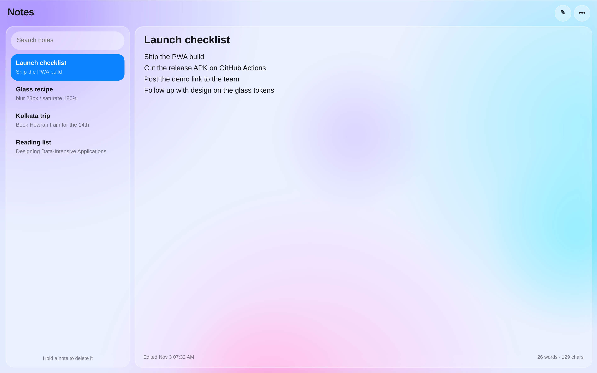
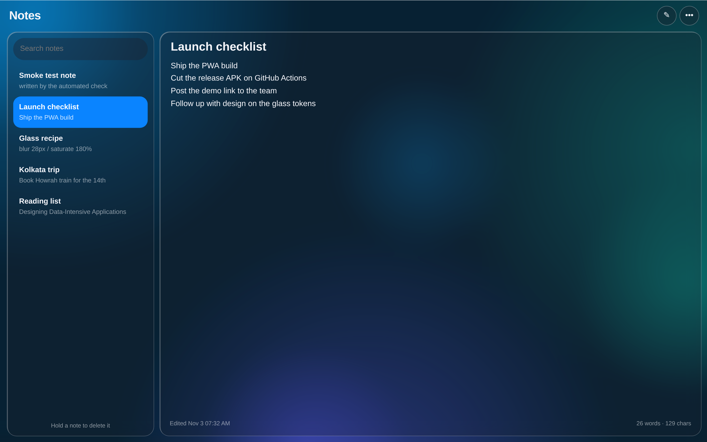
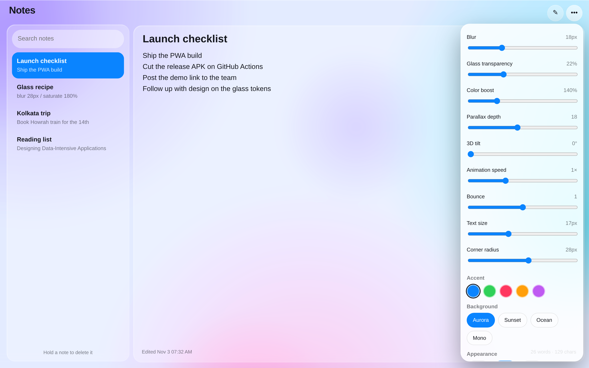
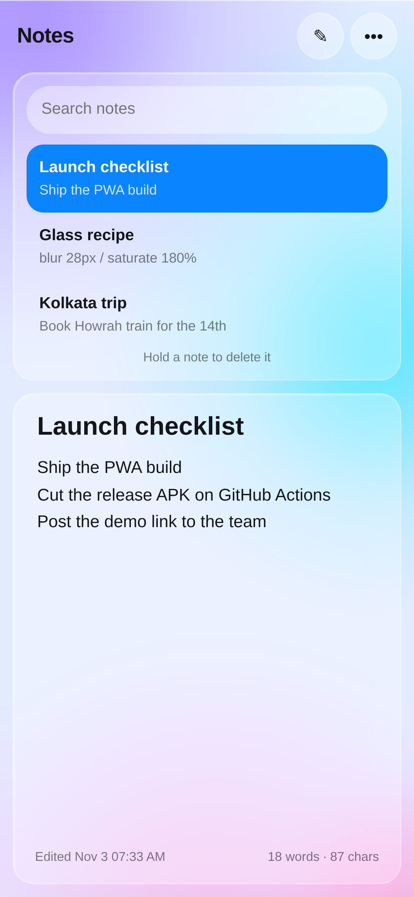

# Liquid Notes

An installable, offline-first note taking app with a liquid-glass interface — a real
Progressive Web App, plus a native Android APK built automatically by GitHub Actions.

**[Open the app →](https://technicalnihilist-lgtm.github.io/liquid-notes/)**

- **Web / PWA:** [technicalnihilist-lgtm.github.io/liquid-notes](https://technicalnihilist-lgtm.github.io/liquid-notes/) — open it and use *Add to Home Screen*; it installs like an app and works with no network.
- **Android:** download `liquid-notes.apk` from [Releases](../../releases) — Android 7.0+ (API 24), **zero permissions**, fully offline.



## What it does

Notes are stored on the device (localStorage) — nothing leaves your phone or browser, there is no account and no server.

- Create, edit, search and delete notes with autosave on every keystroke
- Hold a note in the list to reveal its delete button (with haptic feedback)
- Live word and character count
- Export all notes as **JSON** or **Markdown**, and import a JSON export back
- Light, dark and auto themes that follow your system setting
- Four background palettes (Aurora, Sunset, Ocean, Mono) and five accent colours
- Real glass tuning: blur, transparency, colour boost, corner radius, text size
- Parallax depth and 3D tilt driven by pointer movement or device orientation
- Animated open/close with a launcher icon, plus an optional sound effect
- Full offline support through a service worker, and an in-app install button

### Fixed in 1.2.0 — the repeated crashes

The crash was on the graphics side, not in the note logic. A full-screen
`backdrop-filter` blur sitting inside a 3D `perspective` container, with four
huge `will-change: transform` layers behind it, runs the Android WebView
**renderer** out of memory. When the renderer dies Android kills the whole app
unless the shell handles it — so it "crashed again and again" on the same screen.

- **Renderer crashes are caught, not fatal** — `onRenderProcessGone` returns `true`,
  rebuilds the WebView in lite mode, and keeps the app alive with a short notice.
- **Far less GPU pressure** — the background colour is now one static multi-stop
  gradient instead of four enormous blurred layers; `will-change` is gone from the
  window, the panes and the tilt wrapper; the 3D perspective is applied only when
  tilt is actually enabled; the specular highlight is desktop-only; the default
  blur dropped from 28px to 18px.
- **Three effect levels** — *Auto* (full glass on the web, a cheaper 10px frost
  inside the Android shell), *Lite* (no blur at all) and *Full*. The shell also
  opens in lite mode by itself after a renderer failure.
- **Every crash is now recorded** — an uncaught exception is written to
  `last-crash.txt` and shown on the next launch with a Copy button, and the web
  fallback panel prints the actual stack trace. A report is now actionable.
- **No more blank screen** — `onCreate` is wrapped, page load errors show a native
  Reload / Reload in lite mode screen, and `onTrimMemory` clears WebView caches
  before the renderer is pushed into OOM.
- **Back button is deterministic** — the web app reports its state through the
  bridge, so Back no longer races an async `evaluateJavascript` callback.

Verified by two harnesses: 48 browser checks (corrupt storage, every control,
export/import, offline, touch, reduced motion) and 11 checks that run the app
under the APK's exact conditions — the virtual `https://appassets.androidplatform.net`
origin, no network, no service worker, and a stub native bridge.

### Fixed in 1.1.0

The 1.0.0 build had real defects, found with an automated bug-hunt harness and fixed:

- **Crash on damaged stored data** — a null or malformed note in local storage threw during
  render and left a dead screen. Notes and settings are now sanitised on load, and a
  fallback panel offers Reload / Export / Reset instead of a blank app.
- **Notes lost in the APK** — the shell loaded the app over `file://`, which is not a secure
  context, so `localStorage` was unreliable. Assets are now served from a virtual
  `https://appassets.androidplatform.net` origin.
- **Import did nothing in the APK** — no file chooser was wired into the WebView.
- **Export did nothing in the APK** — blob downloads are ignored by WebView. A native
  bridge now writes the file to `Downloads/Liquid Notes/`.
- **List jumped while typing** — every keystroke re-rendered and re-sorted the sidebar,
  stealing the scroll position. Rows now update in place and re-sort only on blur.
- **Small touch targets** — swatches and chips were under 32 px on phones.
- **Stale UI after an update** — the service worker was cache-first; it is now
  network-first with an offline fallback.
- **Settings panel closed on pick** and slider values could reach invalid states; all
  settings are now clamped and validated.
- Reduced-motion users no longer get the zoom animations, and the manifest no longer
  declares screenshot sizes that do not match the files.

### Screenshots

| Dark mode | Settings | Mobile |
| --- | --- | --- |
|  |  |  |

## Keyboard shortcuts

| Keys | Action |
| --- | --- |
| `Ctrl`/`Cmd` + `N` | New note |
| `Ctrl`/`Cmd` + `F` | Focus search |
| `Esc` | Close the settings panel |

## Run it locally

No build step, no dependencies — it is plain HTML, CSS and JavaScript.

```bash
git clone https://github.com/technicalnihilist-lgtm/liquid-notes.git
cd liquid-notes
python3 -m http.server 8000
# open http://localhost:8000
```

Serve it over `http://` (not `file://`) so the service worker can register and the
app becomes installable.

## Build the Android APK

The `android/` folder is a minimal, dependency-free WebView shell. It has no
libraries at all — no AppCompat, no Capacitor — so the whole APK is a few hundred
kilobytes. The Gradle `copyWebAssets` task mirrors the web app at the repository
root into the APK's assets, so there is only one copy of the source.

```bash
cd android
gradle assembleDebug
# android/app/build/outputs/apk/debug/app-debug.apk
```

You need JDK 17 and Gradle 8.7+. In CI this happens on every push to `main` and on
every `v*` tag, and the APK is attached to the matching GitHub Release.

> The APK is signed with the standard Android debug key, restored from the Actions
> cache so consecutive builds install over each other. For the Play Store, add your
> own keystore and a `signingConfigs.release` block in `android/app/build.gradle`.

## Project layout

```
index.html               app shell
styles.css               liquid glass styling (all tuning via CSS variables)
app.js                   state, rendering, settings, export/import, animations
manifest.webmanifest     PWA manifest (installable, standalone, shortcuts)
sw.js                    service worker — caches the app shell for offline use
icons/                   generated app icons (192, 512, maskable, apple-touch)
screenshots/             captured from the running app with headless Chromium
android/                 WebView APK project (Java, no dependencies)
.github/workflows/       builds the APK and publishes it to Releases
```

## Privacy

No analytics, no network calls, no permissions. The Android build does not even
request `INTERNET`; the web build makes no requests other than loading its own
files. Your notes live in your browser's or WebView's local storage on your device.

## License

MIT — see [LICENSE](LICENSE).
