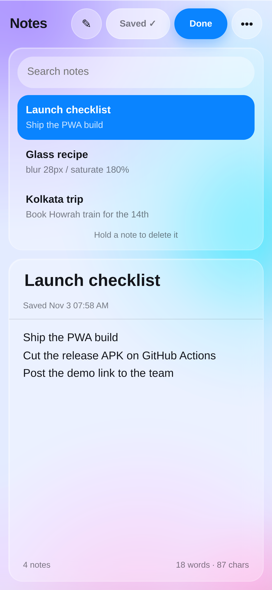

<div align="center">

<a href="https://github.com/technicalnihilist-lgtm/liquid-notes/stargazers"></a>&nbsp;<a href="https://github.com/technicalnihilist-lgtm/liquid-notes/network/members"></a>

<h3>Liquid Notes — an installable, offline-first liquid-glass notes PWA, plus a native Android WebView…</h3>

  

<a href="https://github.com/technicalnihilist-lgtm/liquid-notes/releases/latest"></a> <a href="https://technicalnihilist-lgtm.github.io/liquid-notes/"></a>

<b>Support the work</b>

  

<sub>Donations aren't live yet — Paytm, UPI, PayPal and Buy&nbsp;Me&nbsp;a&nbsp;Coffee all show <b>coming soon</b>. Until then, a ⭐ star is the best support.</sub>

<a href="https://github.com/technicalnihilist-lgtm/liquid-notes/releases/latest"></a>  <a href="https://technicalnihilist-lgtm.github.io/liquid-notes/"></a>

<h4>Get it from</h4>

<a href="https://github.com/technicalnihilist-lgtm/liquid-notes/releases"></a> <a href="https://technicalnihilist-lgtm.github.io/liquid-notes/"></a> <a href="https://github.com/technicalnihilist-lgtm/liquid-notes/archive/refs/heads/main.zip"></a>

</div>

---

---

## What it does

Notes are stored on the device (localStorage) — nothing leaves your phone or browser, there is no account and no server.

- **Title at the top, note below, then Save or Done** — type a title, write the note, press
  **Save** (or `Ctrl`/`Cmd` + `S`) and it is written to the device; press **Done** to save and
  close the app window
- The button reads **Save** while you have unsaved changes and **Saved ✓** once it is on disk,
  and the line under the title says exactly when it was saved
- Create, edit, search and delete notes; drafts are also flushed when you switch notes,
  leave the field, background the app or close it, so nothing is ever lost
- Hold a note in the list to reveal its delete button (with haptic feedback)
- Live word and character count
- Export all notes as **JSON** or **Markdown**, and import a JSON export back
- Light, dark and auto themes that follow your system setting
- Four background palettes (Aurora, Sunset, Ocean, Mono) and five accent colours
- Real glass tuning: blur, transparency, colour boost, corner radius, text size
- Parallax depth and 3D tilt driven by pointer movement or device orientation
- Animated open/close with a launcher icon, plus an optional sound effect
- Full offline support through a service worker, and an in-app install button

### New in 1.3.0 — a real notes app flow

The app was autosave-only, which gives you no moment of "this is saved now". It now
behaves like a notes app:

- A title field sits at the top of the editor with the note underneath, above a hairline.
- **Save** writes the note and the button switches to **Saved ✓**; the state line under the
  title shows the exact save time, and a toast confirms it.
- **Done** saves and closes the app window (back to the launcher icon).
- Save is never a no-op: it is always tappable and always confirms, so a tap never feels dead.
- Switching notes, creating a note, leaving the field, backgrounding or closing the app all
  commit the draft first — the explicit button is for control, not for safety.

Covered by 9 new automated checks (title above body, unsaved marker, Save writes to storage,
button state, toast, list title, survives reload, Ctrl+S, Done closes).

### Fixed in 1.2.0 — the repeated crashes

The crash was on the graphics side, not in the note logic. A full-screen
`backdrop-filter` blur sitting inside a 3D `perspective` container, with four
huge `will-change: transform` layers behind it, runs the Android WebView
**renderer** out of memory. When the renderer dies Android kills the whole app
unless the shell handles it — so it "crashed again and again" on the same screen.

- **Renderer crashes are caught, not fatal** — `onRenderProcessGone` returns `true`,
  rebuilds the WebView in lite mode, and keeps the app alive with a short notice.
- **Far less GPU pressure** — the background colour is now one static multi-stop
  gradient instead of four enormous blurred layers; `will-change` is gone from the
  window, the panes and the tilt wrapper; the 3D perspective is applied only when
  tilt is actually enabled; the specular highlight is desktop-only; the default
  blur dropped from 28px to 18px.
- **Three effect levels** — *Auto* (full glass on the web, a cheaper 10px frost
  inside the Android shell), *Lite* (no blur at all) and *Full*. The shell also
  opens in lite mode by itself after a renderer failure.
- **Every crash is now recorded** — an uncaught exception is written to
  `last-crash.txt` and shown on the next launch with a Copy button, and the web
  fallback panel prints the actual stack trace. A report is now actionable.
- **No more blank screen** — `onCreate` is wrapped, page load errors show a native
  Reload / Reload in lite mode screen, and `onTrimMemory` clears WebView caches
  before the renderer is pushed into OOM.
- **Back button is deterministic** — the web app reports its state through the
  bridge, so Back no longer races an async `evaluateJavascript` callback.

Verified by two harnesses: 48 browser checks (corrupt storage, every control,
export/import, offline, touch, reduced motion) and 11 checks that run the app
under the APK's exact conditions — the virtual `https://appassets.androidplatform.net`
origin, no network, no service worker, and a stub native bridge.

### Fixed in 1.1.0

The 1.0.0 build had real defects, found with an automated bug-hunt harness and fixed:

- **Crash on damaged stored data** — a null or malformed note in local storage threw during
  render and left a dead screen. Notes and settings are now sanitised on load, and a
  fallback panel offers Reload / Export / Reset instead of a blank app.
- **Notes lost in the APK** — the shell loaded the app over `file://`, which is not a secure
  context, so `localStorage` was unreliable. Assets are now served from a virtual
  `https://appassets.androidplatform.net` origin.
- **Import did nothing in the APK** — no file chooser was wired into the WebView.
- **Export did nothing in the APK** — blob downloads are ignored by WebView. A native
  bridge now writes the file to `Downloads/Liquid Notes/`.
- **List jumped while typing** — every keystroke re-rendered and re-sorted the sidebar,
  stealing the scroll position. Rows now update in place and re-sort only on blur.
- **Small touch targets** — swatches and chips were under 32 px on phones.
- **Stale UI after an update** — the service worker was cache-first; it is now
  network-first with an offline fallback.
- **Settings panel closed on pick** and slider values could reach invalid states; all
  settings are now clamped and validated.
- Reduced-motion users no longer get the zoom animations, and the manifest no longer
  declares screenshot sizes that do not match the files.

### Screenshots

| Dark mode | Settings | Mobile |
| --- | --- | --- |
|  |  |  |

## Keyboard shortcuts

| Keys | Action |
| --- | --- |
| `Ctrl`/`Cmd` + `S` | Save the note |
| `Ctrl`/`Cmd` + `Enter` | Save and Done |
| `Ctrl`/`Cmd` + `N` | New note |
| `Ctrl`/`Cmd` + `F` | Focus search |
| `Esc` | Close the settings panel |

## Run it locally

No build step, no dependencies — it is plain HTML, CSS and JavaScript.

```bash
git clone https://github.com/technicalnihilist-lgtm/liquid-notes.git
cd liquid-notes
python3 -m http.server 8000
## Build the Android APK

The `android/` folder is a minimal, dependency-free WebView shell. It has no
libraries at all — no AppCompat, no Capacitor — so the whole APK is a few hundred
kilobytes. The Gradle `copyWebAssets` task mirrors the web app at the repository
root into the APK's assets, so there is only one copy of the source.

```bash
cd android
gradle assembleDebug
## Project layout

```
index.html               app shell
styles.css               liquid glass styling (all tuning via CSS variables)
app.js                   state, rendering, settings, export/import, animations
manifest.webmanifest     PWA manifest (installable, standalone, shortcuts)
sw.js                    service worker — caches the app shell for offline use
icons/                   generated app icons (192, 512, maskable, apple-touch)
screenshots/             captured from the running app with headless Chromium
android/                 WebView APK project (Java, no dependencies)
.github/workflows/       builds the APK and publishes it to Releases
```

## Privacy

No analytics, no network calls, no permissions. The Android build does not even
request `INTERNET`; the web build makes no requests other than loading its own
files. Your notes live in your browser's or WebView's local storage on your device.

## License

MIT — see [LICENSE](LICENSE).

---

## 🌍 Languages

<sub>Donations are <b>coming soon</b> in every language below — nothing to pay today, nothing to click.</sub>

<div align="center">

<sub><b>हिन्दी · বাংলা · मराठी · తెలుగు · தமிழ் · ગુજરાતી · ಕನ್ನಡ · മലയാളം · ਪੰਜਾਬੀ · ଓଡ଼ିଆ · অসমীয়া · اردو</b></sub>

</div>

<details>
<summary><b>🌍 Open the same message in 53 languages</b></summary>

**🇮🇳 Indian languages**

- **हिन्दी** (Hindi) — ☕ जल्द ही आ रहा है। · ⭐ अगर आपको यह ऐप और हमारा काम पसंद है, तो कृपया रिपॉजिटरी को स्टार दें और हमें फॉलो करें।
- **বাংলা** (Bengali) — ☕ খুব শিগগিরই আসছে। · ⭐ যদি আপনার এই অ্যাপ এবং আমাদের কাজ ভালো লাগে, তবে অনুগ্রহ করে রিপোজিটরিটিকে একটি স্টার দিন এবং আমাদের ফলো করুন।
- **मराठी** (Marathi) — ☕ लवकरच येत आहे. · ⭐ जर तुम्हाला हे ॲप आणि आमचं काम आवडलं असेल, तर कृपया रिपॉझिटरीला स्टार द्या आणि आम्हाला फॉलो करा.
- **తెలుగు** (Telugu) — ☕ త్వరలో రాబోతోంది. · ⭐ మీకు ఈ యాప్, మా పని నచ్చితే, దయచేసి రిపోజిటరీకి ఒక స్టార్ ఇచ్చి మమ్మల్ని ఫాలో అవ్వండి.
- **தமிழ்** (Tamil) — ☕ விரைவில் வருகிறது. · ⭐ உங்களுக்கு இந்த ஆப்பும் எங்க வேலையும் பிடிச்சிருந்தா, தயவுசெஞ்சு இந்த ரெபாசிட்டரிக்கு ஒரு ஸ்டார்…
- **ગુજરાતી** (Gujarati) — ☕ ટૂંક સમયમાં આવી રહ્યું છે. · ⭐ જો તમને આ એપ અને અમારું કામ ગમતું હોય, તો પ્લીઝ રિપોઝિટરીને સ્ટાર આપો અને અમને ફોલો કરો.
- **ಕನ್ನಡ** (Kannada) — ☕ ಶೀಘ್ರದಲ್ಲೇ ಬರುತ್ತಿದೆ. · ⭐ ನಿಮಗೆ ಈ ಆ್ಯಪ್ ಮತ್ತು ನಮ್ಮ ಕೆಲಸ ಇಷ್ಟವಾದರೆ, ದಯವಿಟ್ಟು ರೆಪೊಸಿಟರಿಗೆ ಸ್ಟಾರ್ ಕೊಡಿ ಮತ್ತು ನಮ್ಮನ್ನು ಫಾಲೋ ಮಾಡಿ.
- **മലയാളം** (Malayalam) — ☕ ഉടൻ വരുന്നു. · ⭐ നിങ്ങൾക്ക് ഈ ആപ്പും ഞങ്ങളുടെ പ്രവർത്തനവും ഇഷ്ടപ്പെട്ടെങ്കിൽ, ദയവായി റെപ്പോസിറ്ററിക്ക് ഒരു സ്റ്റാർ…
- **ਪੰਜਾਬੀ** (Punjabi) — ☕ ਜਲਦੀ ਆ ਰਿਹਾ ਹੈ। · ⭐ ਜੇ ਤੁਹਾਨੂੰ ਇਹ ਐਪ ਅਤੇ ਸਾਡਾ ਕੰਮ ਪਸੰਦ ਹੈ, ਤਾਂ ਕਿਰਪਾ ਕਰਕੇ ਰਿਪੋਜ਼ਟਰੀ ਨੂੰ ਸਟਾਰ ਦਿਓ ਅਤੇ ਸਾਨੂੰ ਫਾਲੋ ਕਰੋ।
- **ଓଡ଼ିଆ** (Odia) — ☕ ଖୁବ୍ ଶୀଘ୍ର ଆସୁଛି। · ⭐ ଯଦି ଆପଣଙ୍କୁ ଏହି ଆପ୍ ଏବଂ ଆମର କାମ ଭଲ ଲାଗୁଛି, ତେବେ ଦୟାକରି ରିପୋଜିଟୋରୀକୁ ଗୋଟିଏ ଷ୍ଟାର୍ ଦିଅନ୍ତୁ ଏବଂ ଆମକୁ ଫଲୋ କରନ୍ତୁ।
- **অসমীয়া** (Assamese) — ☕ অতি সোনকালেই আহি আছে। · ⭐ যদি আপুনি এই এপটো আৰু আমাৰ কাম ভাল পায়, তেন্তে অনুগ্ৰহ কৰি ৰিপজিটৰীটোক এটা ষ্টাৰ দিয়ক আৰু আমাক ফ'ল' কৰক।
- **اردو** (Urdu) — ☕ جلد آرہا ہے۔ · ⭐ اگر آپ کو یہ ایپ اور ہمارا کام پسند آئے تو براہ کرم ریپازٹری کو سٹار دیں اور ہمیں فالو کریں۔
- **संस्कृतम्** (Sanskrit) — ☕ शीघ्रमेव आगच्छति।
- **मैथिली** (Maithili) — ☕ जल्दिये आबि रहल अछि।
- **कोंकणी** (Konkani) — ☕ रोखडेंच येता.
- **کٲشُر** (Kashmiri) — ☕ جَلدی یِوان چھُ۔
- **سنڌي** (Sindhi) — ☕ जल्द अची रह्यो आहे।
- **डोगरी** (Dogri) — ☕ जल्दी आ करदा ऐ।
- **ꯃꯤꯇꯩ ꯂꯣꯟ** (Manipuri) — ☕ ꯑꯊꯨꯕꯥ ꯃꯇꯝꯗꯥ ꯂꯥꯛꯀꯅꯤ꯫
- **बर’** (Bodo) — ☕ थाबैनो फैगोन।
- **ᱥᱟᱱᱛᱟᱲᱤ** (Santali) — ☕ ᱞᱚᱜᱚᱱ ᱦᱤᱡᱩᱜ ᱠᱟᱱᱟ᱾
- **नेपाली** (Nepali) — ☕ छिट्टै आउँदैछ। · ⭐ यदि तपाईंलाई यो एप र हाम्रो काम मन पर्‍यो भने, कृपया रिपोजिटरीलाई स्टार दिनुहोस् र हामीलाई फलो गर्नुहोस्।

**🌍 World languages**

- **العربية** (Arabic) — ☕ قريبًا. · ⭐ إذا أعجبك هذا التطبيق وعملنا، فيرجى منح المستودع نجمة ومتابعتنا.
- **简体中文** (Chinese (Simplified)) — ☕ 即将推出。
- **繁體中文** (Chinese (Traditional)) — ☕ 即將推出。
- **Čeština** (Czech) — ☕ Již brzy.
- **Dansk** (Danish) — ☕ Kommer snart.
- **Nederlands** (Dutch) — ☕ Binnenkort beschikbaar. · ⭐ Vind je deze app en ons werk leuk?
- **Filipino** (Filipino) — ☕ Malapit na.
- **Suomi** (Finnish) — ☕ Tulossa pian.
- **Français** (French) — ☕ Bientôt disponible. · ⭐ Si cette application et notre travail vous plaisent, mettez une étoile au dépôt et suivez-nous.
- **Deutsch** (German) — ☕ Bald verfügbar. · ⭐ Wenn dir diese App und unsere Arbeit gefallen, gib dem Repository einen Stern und folge uns.
- **Ελληνικά** (Greek) — ☕ Έρχεται σύντομα.
- **עברית** (Hebrew) — ☕ בקרוב.
- **Magyar** (Hungarian) — ☕ Hamarosan.
- **Bahasa Indonesia** (Indonesian) — ☕ Segera hadir. · ⭐ Jika kamu suka aplikasi ini dan karya kami, beri bintang pada repositori ini dan ikuti kami.
- **Italiano** (Italian) — ☕ In arrivo.
- **日本語** (Japanese) — ☕ 近日公開。 · ⭐ このアプリと私たちの仕事が気に入ったら、リポジトリにスターを付けてフォローしてください。
- **한국어** (Korean) — ☕ 곧 공개됩니다. · ⭐ 이 앱과 저희 작업이 마음에 드신다면 저장소에 스타를 눌러 주시고 팔로우해 주세요.
- **Bahasa Melayu** (Malay) — ☕ Akan datang.
- **Norsk** (Norwegian) — ☕ Kommer snart.
- **فارسی** (Persian) — ☕ به‌زودی.
- **Polski** (Polish) — ☕ Wkrótce. · ⭐ Jeśli podoba Ci się ta aplikacja i nasza praca, daj repozytorium gwiazdkę i obserwuj nas.
- **Português** (Portuguese) — ☕ Em breve.
- **Română** (Romanian) — ☕ În curând.
- **Русский** (Russian) — ☕ Скоро. · ⭐ Если вам нравится это приложение и наша работа, поставьте звёздочку репозиторию и подпишитесь на нас.
- **Español** (Spanish) — ☕ Muy pronto. · ⭐ Si te gusta esta app y nuestro trabajo, dale una estrella al repositorio y síguenos.
- **Kiswahili** (Swahili) — ☕ Inakuja hivi karibuni.
- **Svenska** (Swedish) — ☕ Kommer snart.
- **ไทย** (Thai) — ☕ เร็ว ๆ นี้
- **Türkçe** (Turkish) — ☕ Çok yakında.
- **Українська** (Ukrainian) — ☕ Незабаром.
- **Tiếng Việt** (Vietnamese) — ☕ Sắp ra mắt. · ⭐ Nếu bạn thích ứng dụng này và công việc của chúng tôi, hãy tặng kho lưu trữ một ngôi sao và theo…

</details>

